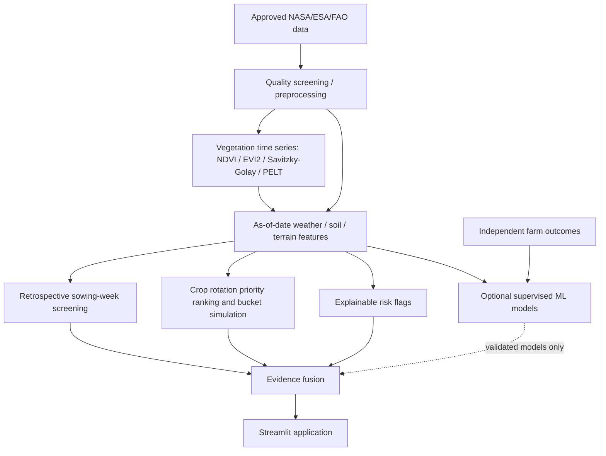

# AgriSim AI architecture — implemented as a modular Python package

The `timeseries/bfast.py` module is intentionally empty. The requested figures are archived in `docs/decision_architecture.png` and `docs/end_to_end_pipeline.png` as target diagrams; they depict features not yet validated or deployed. See `docs/implementation_status.md`.

The source downloader implementation files retain original names inside `data_sources` to preserve tested catalog and Earthdata logic. Their short named counterparts (e.g. `power.py`, `landsat.py`) are CLI entrypoints.
