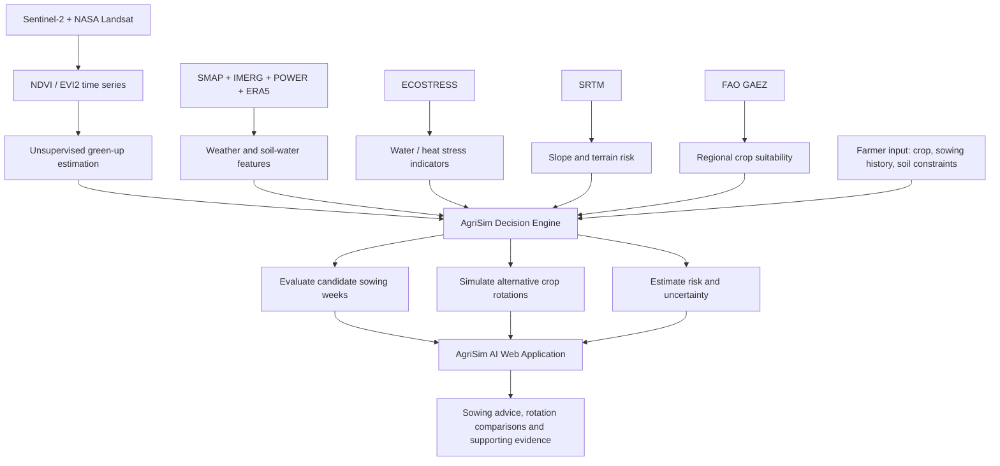

# AgriSim AI designs (Stylianos, 2026-11-14)

| File | What |
|---|---|
| [../../image.png](../../image.png) (also `docs/decision_architecture.png`, lower resolution) | Data → features → decision engine → web app (Mermaid source below) |
| [../../plan.png](../../plan.png) (also `docs/end_to_end_pipeline.png`) | Full pipeline poster: data sources, preprocessing, features, decision engine A–E, app outputs, ML table |

Both are **target designs**: some boxes are not built or validated yet. See the status column below and
[implementation_status.md](../implementation_status.md).

## Decision architecture (editable Mermaid)

## Status of each box (2026-11-14 evening)

| Box | Status |
|---|---|
| Sentinel-2 + Landsat (HLS) → NDVI/EVI2 | ✅ 6 seasons, both sensors; S2 vs HLS gain + offset found (STATUS file) |
| Green-up estimation | ✅ HLS PELT (3 of 6 seasons); S2-only PELT next |
| SMAP + IMERG + POWER → weather / soil-water features | ✅ daily multisource table, 1,819 days × 62 columns; ERA5 not used |
| ECOSTRESS → water / heat stress | ⬜ not wired (units fix needed: mm/day) |
| SRTM → slope / terrain | ✅ elevation, slope, aspect at the pilot |
| FAO GAEZ → crop suitability | ✅ 5 crops |
| Farmer input | ⬜ templates only (`data/reference/*_template.*`) |
| Evaluate candidate sowing weeks | ✅ sowing-window engine v1 ([sowing_window.md](../sowing_window.md)) |
| Estimate risk and uncertainty | ✅ Environmental Risk Engine v1 ([risk_engine.md](../risk_engine.md)) |
| Simulate alternative crop rotations | ⬜ prototype only (`decision_engine/rotation_simulator.py`, `ranking.py`) |
| Web application | ⬜ scaffold only (`app/`) |

Poster items that we deliberately do **not** claim yet: XGBoost / LightGBM models, success probabilities and
"+ confidence" in the poster. These need farm outcome labels, which we don't have. The engines output rule-based
levels and verdicts instead (see the gap report).
