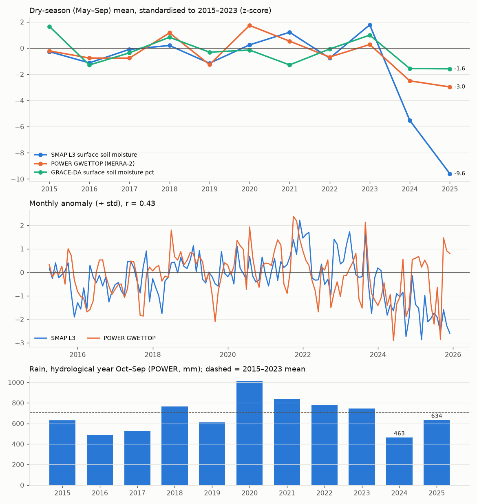

# Is the 2025 SMAP drought real? (2026-11-11)

**Question.** SMAP L3 (`smap_l3_daily_area.parquet`) puts the May–Sep 2025 surface soil moisture at **0.069 m³/m³**,
against 0.15–0.18 in 2015–2023 and 0.107 in 2024. Is that real?

**Answer: the direction is real, the size is not.** 2024 and 2025 are the driest dry seasons since 2015 in every
independent source. But SMAP's 2025 drop is about 3× deeper than the others show, and SMAP stays low all through 2025,
even in months the other data call wet. **Use SMAP 2025 as "very dry, low confidence"; take the 2025 magnitude from
POWER and GRACE-DA.** SMAP 2015–2024 looks consistent with the other sources.

Script: `smap_check.py` · tables: `yearly_dryseason.csv`, `monthly_2024_2025.csv`, `flags_by_year.csv` ·
figure: `smap_check.png`. All NASA data already in `data/processed/` (+ the raw SPL3 flags, re-downloaded for this
check and deleted afterwards).

## 1. Dry-season ranking agrees (rank 1 = driest of 2015–2025)

| Source (May–Sep mean) | 2024 | 2025 | z 2024 | z 2025 |
|---|---|---|---|---|
| SMAP L3 surface soil moisture (satellite) | 2 | **1** | −5.5 | **−9.6** |
| POWER GWETTOP, surface wetness (MERRA-2 model) | 2 | 1 | −2.5 | −3.0 |
| GRACE-DA surface soil moisture percentile (GRACE + model) | 2 | 1 | −1.6 | −1.6 |
| GRACE-DA root-zone percentile | 1 | 3 | −1.4 | −1.3 |
| POWER rain, Oct–Sep | 1 | 6 | −1.5 | −0.5 |
| MODIS ET May–Sep | 1 | 4 | −1.9 | −0.6 |

z = standard deviations from the 2015–2023 mean. In SMAP, 2025 is a **−9.6σ** outlier. The others put 2025 at about
the same level as 2024 (GWETTOP 0.354 vs 0.373; GRACE-DA 16.8 vs 17.1 percentile). Rain and MODIS ET even say 2025 was
*less* dry than 2024 (634 vs 463 mm; 303 vs 239 mm ET). SMAP alone says 2025 was far drier than 2024 (0.069 vs 0.107).

## 2. SMAP is low in the wet months of 2025 too

| Month | SMAP 2025 | SMAP normal (2015–23) | POWER GWETTOP 2025 | GRACE-DA sfsm pct 2025 | Rain (mm) |
|---|---|---|---|---|---|
| Jan | 0.287 | 0.349 | 0.864 (wet) | 54 | 97 |
| Feb | 0.271 | 0.339 | 0.891 (wet) | 40 | 97 |
| Apr | 0.178 | 0.222 | 0.804 (wet) | 51 | 55 |
| Jul | 0.061 | 0.138 | 0.201 | 8 | 9 |
| Oct | 0.187 | 0.259 | 0.725 | 57 | 142 |
| Dec | 0.217 | 0.334 | 0.816 | 49 | 75 |

In 2024 SMAP behaves: normal in Jan–Feb, then low from spring to autumn, as POWER and GRACE-DA show (June 2024 =
GRACE-DA 3rd percentile). In 2025 SMAP starts the year ~20 % below normal and stays there, through a wet winter and
a 142 mm October. A drought would not look like that; a **downward shift of the whole 2025 series** would.

Monthly anomaly correlation SMAP vs POWER GWETTOP: r = 0.48 in 2015–2023, 0.43 with 2024–2025 included.

## 3. SMAP itself changed in 2025

- **Flag mix (AM, study-area cells, May–Sep):** "retrieval skipped" (flag 7) 51–54 % every year 2015–2024, **63 %
  in 2025**; successful retrievals (flag 9) 30–33 % → **21 %**; failed-with-value (flag 13) ≤ 0.7 % → **3.2 %**.
- **Values at the 0.02–0.03 floor:** 0–0.2 % of retrievals in 2015–2024, **5.3 % in 2025**.
- The drop is the same in every cell (cell means 0.068–0.074) and in both AM and PM passes. So it is not one bad
  cell or one overpass time.
- **Not a reprocessing step:** all 3,845 granules come from the same release, `R19240` (from
  `data/processed/appeears_granules.csv`). A web search found no NSIDC advisory for SPL3SMP_E 2025.

Likely causes, **not confirmed**: a change in an input to the retrieval (vegetation water content / opacity,
surface temperature, land/water fraction), or radio-frequency interference. The 2021 burn scar is a candidate for
the vegetation input. But it was there in 2022–2023, when SMAP was fine.

## What to do with it

- **App / engine:** for 2015–2024, SMAP is fine for the seasonal curve and dry/wet anomalies. For 2025, show
  "very dry (SMAP, low confidence)" and take magnitudes from POWER GWETTOP/GWETROOT and GRACE-DA. Never quote SMAP
  absolute m³/m³ (no retrieval here has "recommended quality", see `docs/DATA.md`).
- **Story:** "2024 and 2025 were the two driest summers in the satellite soil-moisture record" holds in all three
  sources. "2025 soil moisture was less than half of normal" holds only in SMAP; don't use it.
- **Later, if useful:** SPL4SMGP (model + SMAP assimilation, still processing on AppEEARS) is a fourth opinion.
  Comparing SMAP against a dryland cell far from the fire would test the burn-scar idea.
